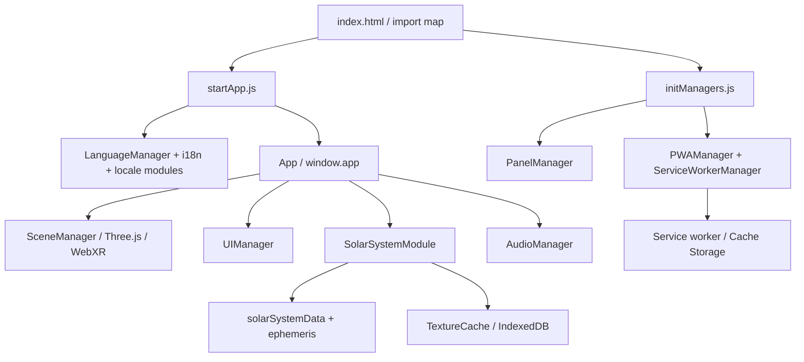

# Space Voyage — Independent QA Review

**Audit date:** 2026-11-27

**Baseline:** `main`, commit `9ecd81e5dd3f8e801e6221b7f0bab104ba76d51b`, application `2.10.326`. The worktree was clean at the start; this report is the only intended repository change. The requested reference commit is the checked-out commit.

**Independence qualification:** This review was conducted by an AI assistant that also contributed to the immediately preceding ring and camera changes. It is not a review by independent human specialists. Its findings should be independently checked before release decisions.

## A. Executive summary

Space Voyage has substantive functionality and useful regression tests, particularly around scaling, camera tracking, rendering and localization. It has a self-hosted rendering dependency, a version-synchronized cache manifest and disclosed educational time compression. It is not appropriate to treat its current scientific mode as a reliable ephemeris: the planetary frame transform is incomplete, a supported comet can cause numerical non-convergence, and Triton's orbital direction is reversed twice. A service-worker activation can delete caches belonging to unrelated applications sharing the origin; fatal recovery can also unregister unrelated workers and request deletion of unrelated IndexedDB databases.

The five most important risks are **Q01** shared-origin storage deletion, **Q02** incorrect scientific planetary positions, **Q03** unstable high-eccentricity solver, **Q04** incorrect Triton direction, and **Q05** mixed-version application updates. Address isolation first, then scientific model and update consistency, with independent numerical and browser regression tests. **Q06** keyboard focus and **Q07** concurrent language selection also require attention.

The subsequent IWER follow-up also found involuntary grip rotation (**Q15**), a snap-turn reset defect (**Q14**), frame-dependent locomotion (**Q16**), untranslated VR controls (**Q17**) and misleading educational-mode speed feedback (**Q19**). A desktop mode-switch round trip can change paused educational positions (**Q18**).

This is a risk-based review, not evidence that every requested subsystem or historical finding was exhaustively verified. The coverage and reconciliation registers explicitly mark gaps. No physical headset, real mobile device, screen reader, Firefox or WebKit was tested. Performance traces and a complete resource-leak investigation were not available. Do not infer platform certification or WCAG conformance from this report.

## B. Repository and architecture

The project is a static ES-module application, not a bundled build. `package.json` records `2.10.326`; the import map pins self-hosted Three.js `0.186.1`. Installed development tools include Playwright `1.64.0`, ESLint `10.12.0` and http-server `14.1.1`. The audited Windows host ran Node `26.13.0`; CI specifies Node `20`.



`App` owns selected mode, speed, controls and startup; `SolarSystemModule` owns simulated time, celestial data and scene objects; `SceneManager` owns renderer, camera, controls and XR/dolly; UI and other managers exchange state via `window.app`, globals, DOM events and direct calls. Boot warms IndexedDB textures, constructs managers and scene objects, then starts the render loop. The service worker registers independently after page load. `SolarSystemModule.cleanup()` disposes many scene resources; `SceneManager.dispose()` releases renderer and controls. There is no demonstrated end-to-end App lifecycle that unregisters every global listener and timer; repeat initialization and teardown were not measured.

The large files are approximately 467 KB (`SolarSystemModule.js`), 129 KB (`SceneManager.js`) and 63 KB (`main.js`). Size alone is not a defect: object creation is inherently broad. The material issue is that simulation, orbital reference frames, procedural assets, picking and camera behavior share mutable state. Existing extraction of data and numerical functions is useful, but Q02–Q04 show that extraction alone does not establish a consistent physical model.

## C. Historical findings reconciliation

Status definitions are those in the assignment. An unchecked historical item is **not** treated as proof that it is still defective. Entries marked **Unable to verify** need their original reproduction rerun; historical issue descriptions are not independently validated by this register. Existing tests are cited where known; a test's existence is not proof of broad coverage.

### Engineering review, 2026-06-12

| Original finding | Status and current evidence / test gap |
|---|---|
| Architecture P1, monolith | Partially resolved: data and numerical helpers extracted; large mixed-responsibility module remains (section B). No measured parse-time comparison. |
| Architecture P2 / performance P1, six-locale blocking bundle | Resolved in implementation but insufficiently performance-tested: `src/i18n.js:4` loads locale modules dynamically; startup still awaits English and selected locale. No trace available. |
| Architecture P3 / performance P4, recreated navigation maps | Resolved in implementation but insufficiently benchmarked: `src/main.js:81,876` hoists patterns and caches the instance map. |
| Architecture P4 / performance P5, event table | Superseded: the old Time Machine event UI was removed; inspect `BACKLOG.md:77`. No claim that all date features were removed. |
| Architecture P5 / Q6 / security S1–S2, globals | Partially resolved: unused modal globals removed (`src/main.js:641`); `window.app` and `window.audioManager` remain. These globals are coupling, not an independently proven exploitable vulnerability. |
| Architecture P6 / performance P3 / security S4, search `innerHTML` | Resolved in implementation but insufficiently performance-tested: current source has no application `innerHTML` assignment in `src/`; filtering is in `src/main.js:1504`. |
| Q1 / C2, duplicate storage precache | Resolved and verified by the static manifest uniqueness check (`tests/static-regression.spec.js:51`). |
| Q2 / reliability R3 / C3 / C6 / tooling T6, version drift | Resolved and verified by `npm run version:check`; synchronization remains a release prerequisite. |
| Q3, duplicated translation shim | Still applicable as a maintainability concern: globals and local translation wrappers remain (`src/main.js:24`, `src/modules/LanguageManager.js`). |
| Q4 / C7, legacy scale preferences | Unable to verify migration safety and whether remaining compatibility branches are obsolete. |
| Q5 / security S3, monkey-patched console | Resolved in implementation: renderer sets `debug.checkShaderErrors = false` (`src/modules/SceneManager.js:157`); search found no `console.warn` assignment. Shader-error visibility needs separate consideration. |
| Q7, synthetic DOM dispatch | Still applicable: `src/modules/UIManager.js:380` dispatches slider input; shortcuts also invoke UI elements. Not inherently a security issue. |
| Performance P2, large module parse | Unable to verify measurable impact; file remains large, but no cold-load trace. |
| Performance P6, event-handler vector allocations | Unable to verify material impact; event-path allocation alone is not a demonstrated performance defect. |
| Performance P7 / UX1, localized loading facts | Unable to verify language-switch behavior during loading. |
| Reliability R1–R2 / tooling T1–T4, absent tests, lint, npm, CI, formatting config | Resolved in implementation: `package.json`, `eslint.config.js`, `.editorconfig`, `.github/workflows/ci.yml`, and five test files exist. The quality and breadth of these gates remain separate questions. |
| Reliability R4, no SW manifest validation | Partially resolved: static literal-list, duplicate and selected addon-closure tests exist; Q08 describes their boundary. |
| Reliability R5 / UX4, close-button workaround | Resolved in implementation but insufficiently interaction-tested: event handlers are explicit (`src/main.js:641–681`). |
| Reliability R6, Time Machine listener cleanup | Superseded by removal of the old event UI; repeat App teardown remains unverified. |
| Security S5, inline styles in CSP | Still applicable as a policy tradeoff (`index.html:14`); no exploit established. |
| UX2, Escape closes every modal | Resolved in implementation but insufficiently independently retested; keyboard test exists at `tests/e2e/keyboard-shortcuts.spec.js:100`. |
| UX3, raw search query text | Unable to verify independently; current DOM construction should be reviewed in its actual user-input path. |
| UX5, settings shortcut | Unable to verify whether a shortcut is required by current product design. |
| UX6, timed Earth preselection | Unable to verify timing under slow startup; current startup has a force-start timeout (`src/main.js:248`). |
| C1, committed diff files | Resolved and verified by root inventory: `diff.txt` and `diff1.txt` are absent. |
| C4, tracked virtual environment | Resolved and verified: `.venv` exists locally but `git ls-files .venv` returned nothing. |
| C5, historical scientific report | Superseded as a cleanup recommendation: retaining an explicitly historical report is useful; do not delete it. |
| C8, modal globals | Partially resolved: obsolete close globals removed; `window.app` remains. |
| T5, local HTTPS | Still applicable as a testing limitation: default server is HTTP localhost. Loopback secure-context exceptions do not prove deployed HTTPS or device XR. |

### Scientific review, 2026-06-05

| Original finding | Status and current evidence / remaining verification |
|---|---|
| ORB-1, comet Y coordinate hardcoded | Resolved in implementation: inclinations are stored (`SolarSystemModule.js:7103–7126`) and applied (`:9427–9432`); independent 3D orbital-frame accuracy remains unverified. |
| ORB-2, missing lunar ascending node | Still applicable: `_updateMoonPosition()` uses inclination and periapsis but no node (`SolarSystemModule.js:3505–3517`); Q04 adds a direction error. |
| ORB-3, no precession | Still applicable: static elements in `solarSystemData.js`; date validity and actual errors remain unquantified. |
| ORB-4, contradictory trajectory scale comment | Unable to verify every historical comment; current `_probePositionAtJD()` and `updateSpacecraftPositions()` should be checked together. |
| DESC-1, Jupiter shield; DESC-2, Voyager distances; DESC-3, Saturn ring thickness; DESC-4, Hale-Bopp size; DESC-5, Pioneer plaque; DESC-6, lunar stabilisation | Resolved in English implementation (`src/locales/en.js:286,375–376,409–424`); all other languages and authoritative claim-by-claim verification remain incomplete. |
| SC-1, New Horizons region terminology | Unable to verify current NASA-recommended wording and all translations. |
| DOC-1, Three.js README version | Unable to verify all documentation claims; import map definitively uses `0.186.1`. Agent instructions are demonstrably stale (Q09). |
| ORT-1, Oort Cloud light travel | Resolved in English implementation (`src/locales/en.js:506`); other locales not independently fact-checked. |
| Historical planetary sizes/tilts/rotation-period blanket pass | Unable to verify as a blanket claim. Saturn's selected values were independently compared below; no assumption is made for every planet/moon. |
| Historical trajectory, event, constellation and source-attribution blanket passes | Unable to verify as blanket claims; selected planetary Horizons comparisons do not verify spacecraft trajectories, events, asset provenance or multilingual content. |
| Belt density and illustrative scale disclosure | Partially resolved: README explains compressed educational timing and scale, but belt-specific learner-facing disclosure was not established. |
| Historical claim of correct orbital mechanics | Regressed / contradicted by current evidence: Q02–Q04. The earlier conclusion that date-seeded phases imply correct positions was not a sufficient verification. |

### Subsequent backlog reconciliation

Each row covers the cited item or the immediately following explicitly enumerated resolved entries. Statuses do not inherit checkbox states.

| Backlog reference and finding | Current classification / evidence |
|---|---|
| `BACKLOG.md:19`, offline addon closure | Resolved in implementation but insufficiently tested: self-hosted closure and static check exist; incomplete installation and all dynamic imports remain untested. |
| `:37`, manifest shortcuts | Resolved in implementation but insufficiently tested: `src/main.js` reads startup selection; actual OS shortcuts not tested. |
| `:55`, npm audit advisories | Unable to verify: configured audit endpoint returned HTTP 429; vendored Three.js is outside npm audit. |
| `:77`, obsolete Time Machine event UI | Superseded: old UI removed; date controls and keyboard date functionality have since evolved. |
| `:95`, competing speed-panel drags | Unable to verify independently; panel drag tests exist. |
| `:113`, XR UI/selection synchronisation | Partially resolved: code has XR navigation and UI update paths; physical XR selection remains unverified. |
| `:131`, orbit visibility on rebuild | Resolved in implementation but insufficiently independently retested; application tests cover related scale changes. |
| `:153`, outdated documentation | Still applicable: Q09. |
| `:190`, CDN-hosted Three.js | Resolved in implementation: import map uses local `vendor/three@0.186.1`; provenance and vulnerability tracking remain incomplete. |
| `:224`, unbounded/base64 IndexedDB texture cache | Still applicable by static inspection (`TextureCache.js:8–14,128–155`); actual quota impact not measured. |
| `:250`, lint/diagnostics baseline | Still applicable: 202 warnings, zero errors; CI does not fail on warnings. |
| `:273`, modal focus | Partially resolved: focus restore was added, but Q06 reproduces escape via a hidden element. |
| `:299`, long timeout masking failure | Still applicable: `tests/e2e/full-functionality.spec.js:80` sets 900 seconds; actual impact depends on failure. |
| `:323`, service-worker quota | Still applicable by static inspection: cache-write errors share offline handling (`sw.js:291–344`); quota exhaustion not induced. |
| `:343`, FIFO cache trimming | Still applicable (`sw.js:435–445`); material runtime impact unmeasured. |
| `:362`, duplicated language configuration | Still applicable: lists and manifest maps appear in both `i18n.js` and `LanguageManager.js`; see Q07 for an independent concurrency issue. |
| `:384`, Web Audio node release | Unable to verify actual accumulation; nodes are stopped but explicit lifecycle measurement was not performed. |
| `:404`, z-index tokens | Unable to verify a user-visible defect; optional maintainability work. |
| `:422`, duplicated belt loops | Unable to verify current duplication or measurable impact. |
| `:441`, automated accessibility audit | Still applicable: existing accessibility suite is focused and no axe-equivalent dependency/gate was identified. |
| `:459`, automated dependency/action updates | Unable to verify repository settings; no Dependabot configuration was found in the local `.github` inventory. |
| `:481`, button type | Unable to verify every button and associated form context. |
| `:498`, nested loading live region | Unable to verify effect with assistive technology. |
| `:513`, stable IDs for object lookup | Partially resolved: many bodies have IDs; some navigation patterns still use display-name strings (`src/main.js:81`). |
| `:532`, star twinkle batch size | Unable to verify whether naming has meaningful benefit. |
| `:547`, laser throttle comment | Unable to verify current comment. |
| `:562`, dead VR state | Unable to verify lifetime and reachability of each state field. |
| `:578`, haptic handedness | Still applicable by static inspection: `triggerVRHaptic` indexes `session.inputSources` (`SceneManager.js:2548–2565`). Physical input ordering untested. |
| `:595`, CI artifact retention | Still applicable as a retention policy choice: seven days (`.github/workflows/ci.yml`); adequacy requires team requirements. |
| `:617–672`, full-functionality test, mobile texture maps, double reload, listener duplication, addon cache, manifest parity, share target, IndexedDB error/transaction, fatal boot surface, fallback diagnostics, reduced motion, skip links, decorative SVGs, shortcut XR guard | Partially resolved / insufficiently tested as a group: code and existing targeted tests show mitigations; no independent complete replay of each old failure. The fatal recovery mitigation introduces Q01. |
| `:688`, cohesive SolarSystemModule boundaries | Partially resolved: extracted data and ephemeris; section B and Q02–Q04 show remaining shared-state risk. |
| `:715`, six-locale render blocking | Resolved in implementation but insufficiently performance-tested; same as engineering P2. |
| `:742`, global app and synthetic clicks | Still applicable as coupling; no event bus is prescribed absent a demonstrated need. |
| `:764`, XR/animation resource leaks | Unable to verify leak incidence; `SceneManager.dispose()` exists and partial cleanup is visible. |
| `:791`, large VR menu | Still applicable as complexity; dirty-flag redraw is implemented (`SceneManager.js:3183`). No redraw-cost measurement. |
| `:810`, UI test coverage | Partially resolved: tests now cover numerous controls, but coverage gaps remain in section H. |
| `:830`, boot recovery | Superseded by `FatalError.js`; safety of its clearing operation is defective (Q01). |
| `:859`, formatting enforcement | Unable to verify full conformance; `.editorconfig` exists, but no repository-wide formatter gate was demonstrated. |
| `:879`, warnings | Still applicable / superseded by `:250`: 202 warnings. |
| `:902`, VR magic numbers | Unable to verify specific measurable impact; avoid configuration extraction solely for count. |
| `:921`, hoist data tables | Partially resolved: navigation patterns and VR tab definitions are hoisted; not every table was inspected. |
| `:939`, timer-based boot/hints | Still applicable: startup safety timeout and onboarding timeout remain (`main.js:248`, `AppFeatures.js:18`). Their need and failure impact need targeted tests. |
| `:957`, App lifecycle | Partially resolved: scene and solar disposal exist; App-wide listener/timer ownership remains unverified. |
| `:975`, translation contract | Still applicable: duplicated language configuration and global shims persist. |
| `:994`, pickable object registration | Unable to verify complete inventory; existing picking tests exercise selected cases. |
| `:1016`, documentation consolidation | Unable to determine desired hierarchy; Q09 addresses demonstrated drift rather than prescribing a directory move. |
| `:1033`, mark engineering review historical | Still applicable: the old report has its original date and snapshot but no explicit superseded banner. |
| `:1052`, committed test artifacts | Resolved and verified for current tracked root inventory; test outputs exist locally but are not shown in clean git status. |
| `:1067`, CSP reporting / inline style | Still applicable as a policy choice; no reporting endpoint was verified. |
| `:1086`, reduced motion | Partially resolved: implementation and test exist; broad motion behavior and vestibular accessibility are not certified. |
| `:1105`, contribution documentation | Unable to verify whether a separate contributor document is necessary; README documents no-build workflow. |
| `:1130–1147`, modifier/input shortcut guards, Escape ordering, dead globals, atomic precache, revalidation, SW diagnostics, CSP-safe fallback, logging, removed analytics, paused localization, storage errors, global error handler, unused locals/translation shims, crawler tags, lockfile, lint/CI/versioning | Partially resolved / insufficiently independently replayed: implementation and corresponding test/tooling improvements exist; do not treat historical checkboxes as proof for every original reproduction. |

Duplicates include the old blocking i18n, global state, cache version, lint warnings and missing tooling findings repeated across reviews. `BACKLOG.md:715` still describes the old blocking i18n despite current lazy modules; `:273` predates focus restoration but Q06 shows the original concern is not fully solved. The prior scientific blanket accuracy verdict conflicts with the independently calculated Q02 result.

## D. Quality scorecard

Scores are risk-based, not statistical measures. **10** means evidence supports the stated use across representative conditions; **5** means a usable baseline with material gaps or defects; **0** means the assessed purpose cannot be met. **NV** means insufficient evidence. No overall score is calculated.

| Category | Score | Basis |
|---|---:|---|
| Scientific data accuracy | NV | Only selected Saturn data and a few English statements independently checked. |
| Orbital mathematics | 3 | Useful Kepler implementation at moderate eccentricities; Q02–Q04 materially affect scientific results. |
| Educational integrity | 4 | Educational timing is disclosed, but the README's scientific-accuracy claim exceeds demonstrated behavior. |
| Functional correctness | 5 | Focused desktop checks and tests work; storage isolation, language races and focus handling have confirmed defects. |
| Software architecture | 5 | Cohesive data extraction and explicit rendering manager exist, alongside shared state and lifecycle coupling. |
| Code maintainability | 5 | No-build architecture and tests help; large mixed-responsibility modules and 202 lint warnings hinder review. |
| Rendering quality | NV | Selected ring pixel/depth test exists; visual quality and hardware matrix were not comprehensively assessed. |
| Runtime performance | NV | No Chrome DevTools trace, representative hardware measurements or Core Web Vitals. |
| Resource management | NV | Cleanup paths exist, but repeated-session CPU/GPU/heap growth was not measured. |
| WebXR quality | NV | IWER exercises selected controller and lifecycle flows, revealing Q14–Q17 and Q19; physical XR validation is still absent. |
| PWA/offline reliability | 4 | A fresh isolated Chromium offline boot passed, but Q01 and Q05 are serious shared-origin isolation/update risks. |
| Security/privacy | NV | Partial CSP and storage review only; npm audit failed and vendored-library advisories were not checked. |
| Internationalization | 5 | Key parity is complete, but Q07 is reproducible and translation accuracy was not comprehensively assessed. |
| Accessibility | 4 | Skip link, semantics and reduced-motion support exist; Q06 and incomplete assistive-technology coverage prevent conformance claims. |
| User experience | NV | No representative user or device study. |
| Browser compatibility | NV | Only Chromium; mobile emulation is not a physical mobile browser. |
| Automated testing | 5 | Browser, static and focused behavior tests exist; independent science, isolation and real update tests are missing. |
| CI/CD/deployment | 5 | Lockfile, version check, lint and tests are configured; deployment, branch protection, action pinning and rollback were not validated. |
| Documentation | 4 | Helpful workflows and speed disclosures coexist with overstated scientific/offline claims and stale agent instructions. |

## E. Detailed findings

Severity denotes risk, not confidence. Effort estimates assume a contributor familiar with the project and exclude unbounded physical-device certification.

### Q01 — Application activation and recovery delete unrelated origin storage

**P1; security/isolation and reliability; confidence high; confirmed by static inspection and isolated mock execution.** Affects sibling GitHub Pages apps, their offline data and service workers.

- **Evidence:** `sw.js:202–212` deletes every cache not equal to one of this release's three cache names. `src/modules/ServiceWorkerManager.js:52–54` registers only `./`, but Cache Storage is shared by the origin. `src/modules/FatalError.js:24–47` unregisters every origin registration and requests deletion of every origin cache and IndexedDB database. `TextureCache.js:10` names this app's database `SolarSystemTextureCache`. `Promise.all` on `IDBOpenDBRequest` objects does not wait for database delete success; `Promise.allSettled` hides failure.
- **Expected:** Only explicitly owned app caches, the app registration and explicitly owned databases are touched; deletion completion/failure is reported.
- **Actual / reproduction:** Execute the `activate` handler in a Node `vm` with in-memory cache names `space-voyage-v2.10.325`, `space-voyage-v2.10.326`, `other-app-cache`: it deletes both the old app cache and `other-app-cache`. This test used no real browser storage. The fatal dialog's clear action is broader still; **do not reproduce against a shared real origin**.
- **Root cause / impact:** Scope filtering is missing from origin-wide APIs. Normal activation can disrupt other apps' offline behavior; recovery can remove data or registrations owned by other apps. Permanent loss depends on what those apps store.
- **Fix / effort / risk:** Restrict cleanup to unambiguously app-owned cache prefixes and registration scope; explicitly enumerate owned DB names and await `success`, `error` and `blocked` events. Consider coexistence of versions and tabs before deleting. Small–medium effort; medium regression risk.
- **Acceptance / tests:** Mock and isolated-browser tests prepopulate unrelated cache, registration and DB; activation and recovery must preserve all three, remove only intended app data, wait for completion and report blocked/failing deletions. Exercise multiple tabs and update/rollback. This finding also applies to Q05.

### Q02 — Scientific planet positions omit the ascending-node rotation

**P1; scientific/educational integrity; confidence high; confirmed by independent JPL comparison and static trace.** Affects date-based scientific planet positions, orbit orientation and associated views.

- **Evidence:** `src/modules/solarSystemData.js:125–145` stores eccentricity, inclination and argument of periapsis but no longitude of ascending node. `SolarSystemModule.js:3614–3628,9236–9247` computes `theta = true anomaly + periapsis` and rotates only inclination. JPL requires the further node rotation: [JPL Approximate Positions of the Planets](https://ssd.jpl.nasa.gov/planets/approx_pos.html), formulae 2–5, Table 1, J2000 ecliptic/equinox.
- **Expected / actual:** Against a separate bisection implementation of JPL Table 1, app heliocentric ecliptic longitude at J2000 differs by −48.36° for Mercury, −49.61° for Mars and −112.91° for Saturn. At 2025-01-01 UTC the differences are −48.40°, −49.71° and −113.19°, respectively. Earth differs by −0.035° and −0.116°. UTC was used as a practical approximation to JDTDB; the seconds-scale time-standard difference cannot explain tens of degrees. The values compare model formulas and data, not a live JPL Horizons query.
- **Independent cross-check:** [JPL Horizons](https://ssd-api.jpl.nasa.gov/doc/horizons.html) Sun-centered geometric vectors in the J2000 ecliptic give app-minus-Horizons longitudes of −48.3555°, −49.6094° and −113.0528° for Mercury, Mars and Saturn at JD 2451545.0 TDB, and −48.3961°, −49.7060° and −113.1154° at JD 2460676.5 TDB. These are separate from the Table 1 approximation above; see section F for inputs and limits.
- **Root cause / impact:** The code treats an argument of periapsis as if the node were zero. Most planets consequently appear in the wrong heliocentric direction for the selected date. This contradicts the unqualified “scientifically accurate orbital mechanics” statement (`README.md:40`).
- **Reproduction:** For each date calculate mean anomaly from `PLANET_ELEMENTS_J2000`, solve Kepler, apply the current `theta`/inclination equations and take `atan2(z,x)`; compare with JPL's node-inclusive Table 1 calculation. Example: at JD 2451545.0 Saturn is 292.6694° in the app versus 45.5786° in the JPL approximation.
- **Fix / effort / risk:** Introduce an explicit, documented J2000 reference frame and complete node/inclination/periapsis transform consistently in seek, per-frame updates and orbit geometry. Keep educational scaling separate from physical coordinates. Medium–large effort; high regression risk to camera, paths, direction and existing saved dates.
- **Acceptance / tests:** Compare several independently sourced positions for Mercury, Earth, Mars and Saturn at J2000 and 2025 with a declared tolerance and frame; test inclined/retrograde bodies and path/marker agreement. A provisional 1° educational tolerance would still reject the measured errors; choose production tolerances based on the adopted model. Document actual validity rather than borrowing JPL's range for a different implementation.

### Q03 — High-eccentricity Kepler iteration can diverge for an included comet

**P1; numerical/scientific correctness; confidence high; confirmed by execution.**

- **Evidence:** `src/modules/ephemeris.js:30–38` uses 12 unconstrained Newton steps without convergence/residual validation. `SolarSystemModule.js:7114,7367–7384,10395–10428` includes Hale–Bopp at `e=0.995` in realistic scale; both seek and per-frame updates use the helper.
- **Expected / actual:** With `e=0.995`, `M=6.2489419472554575`, the returned eccentric anomaly is −38,813,918.6493 radians, with equation residual −38,813,924.8121 radians. Independent monotonic bisection gives `E=5.7060174539` radians. App true anomaly is 4.8551 radians versus 3.4757; output may be finite yet physically wrong. A 100,001-point sweep found 464 residuals above `1e-8` at `e=0.995`.
- **Reproduction:** `node --input-type=module -e \"import {solveKepler} from './src/modules/ephemeris.js'; let e=.995,m=6.2489419472554575,E=solveKepler(m,e); console.log(E,E-e*Math.sin(E)-m)\"`. For the configured Hale–Bopp perihelion JD/period this mean anomaly corresponds approximately to 1983-06-10 05:24 UTC; use scientific mode and date seek to exercise integration.
- **Root cause / impact:** Newton steps can escape the root basin and terminate at the iteration cap without checking residual. Comet position and velocity can jump or become wrong near perihelion.
- **Fix / effort / risk:** Normalize mean anomaly, validate `0 <= e < 1`, use a bracketed or safeguarded solver, and surface non-convergence. Small–medium effort; medium risk to existing orbit visuals.
- **Acceptance / tests:** Verify residual < `1e-10` radians for representative and densely sampled `M`, including `e=0, 0.855, 0.967, 0.995, 0.999`, negative and multi-revolution inputs; independently compare the 1983 Hale–Bopp seek and forward/reverse continuity.

### Q04 — Triton's retrograde direction is applied twice

**P1; scientific/educational integrity; confidence high; confirmed by static mathematical trace and numerical evaluation of the implemented transform.**

- **Evidence:** `SolarSystemModule.js:792–798,3448,3659–3661,9293–9302` assigns negative angular velocity and phase; `solarSystemData.js:176` assigns inclination `156.90°`; `SolarSystemModule.js:3505–3513` multiplies the orbital Z component by `cos(inclination)`, which is negative. At a 0.01-radian step, the signed XZ cross-product proxy is +0.010000 for prograde, −0.010000 for educational Triton and +0.009198 for scientific Triton.
- **Expected / actual:** A retrograde orbit should have angular momentum opposite the parent-equatorial prograde direction. In scientific mode, the negative angular rate and negative cosine cancel in the XZ angular motion; with Neptune's tilt the normal still projects on the same side as the model's prograde ecliptic normal. Educational mode omits inclination and uses the negative rate once. Thus the apparent direction differs between modes.
- **Reproduction:** Set Triton near angle zero and compare the sign of the parent-relative XZ cross product before and after a small positive-time update in each mode; account for the parent's current world quaternion.
- **Fix / effort / risk:** Encode orbital direction once, define inclination's reference plane and transform it into the parent-equatorial frame. Medium effort; medium–high risk to tidal locking and orbit paths.
- **Acceptance / tests:** Parent-relative angular momentum has the intended retrograde sign in both modes, remains so across planet spin, reverse time and a scale switch, and agrees with the drawn path. Independently validate the inclination and reference plane.

### Q05 — A waiting worker can mix new HTML with old cached modules

**P1; update reliability; confidence high for the cache behavior, medium for real-world impact; confirmed by isolated mock execution.**

- **Evidence:** `sw.js:175–182` intentionally waits for user activation; `sw.js:229–245` strips version queries from cache keys; `sw.js:258–260,280–315` serves HTML network-first but JS cache-first. `ServiceWorkerManager.js:125–138` asks the waiting worker to activate only on update action.
- **Expected:** HTML and all imported modules should be from a compatible application version while an old worker controls a tab.
- **Actual / reproduction:** In an isolated `vm`, dispatch a script fetch for `https://example.test/Solar/src/main.js?v=NEW` to an old-worker cache containing `OLD cached script`. The worker requests the unversioned cache key and returns the old script with zero network calls. A separately fetched new HTML document can therefore request new-version URLs and receive old modules before activation.
- **Root cause / impact:** Network-first shell plus cache-first, query-normalized assets has no transactional version boundary. Actual breakage depends on compatibility between adjacent versions; it may cause boot failures or subtle inconsistencies.
- **Fix / effort / risk:** Choose a coherent update protocol: keep the old shell with its old worker or maintain version-specific asset URLs/caches until the new shell and worker switch atomically. Preserve multi-tab and rollback behavior. Medium–large effort; high PWA regression risk.
- **Acceptance / tests:** Two-release controlled server tests exercise old/new shell and worker, updates dismissed/accepted, two tabs, interrupted install and rollback; every observed HTML/module graph must belong to one compatible version. Avoid indiscriminately deleting old caches; coordinate with Q01.

### Q06 — Settings dialog keyboard focus can escape

**P2; accessibility; confidence high; confirmed in isolated Chromium.**

- **Evidence:** `src/modules/UIManager.js:198–217` builds a focusable list including hidden controls; `index.html:446–458` has a language selector followed by a visually hidden sound input.
- **Expected / actual:** Tab from the last actually focusable control must remain in the modal. In a clean isolated browser, opening Settings, focusing `#language-selector` and pressing Tab left focus on `<body>` (`inside=false`); computed sound input display was `none`.
- **Root cause / impact:** The trap treats a non-focusable hidden checkbox as the last element, so it does not wrap at the real last tab stop. Keyboard and assistive-technology users can lose dialog context.
- **Fix / effort / risk:** Determine genuinely visible, enabled, tabbable elements on each Tab and handle empty/focus-outside cases; preserve focus restoration and nested-dialog behavior. Small–medium effort; medium interaction risk.
- **Acceptance / tests:** Repeated Tab and Shift+Tab on settings, help, onboarding and install dialogs never escape; closing restores the invoking control. Verify hidden/disabled controls and screen-reader behavior.

### Q07 — Rapid language changes can resolve in the wrong order

**P2; internationalization/UX; confidence high; confirmed in isolated Chromium.**

- **Evidence:** `src/i18n.js:124–141,199–201` awaits a dynamic import, then applies the result without checking whether a newer request exists.
- **Expected / actual:** The last selection wins. With uncached French delayed 1.5 s and Dutch delayed 0.1 s, selecting French then Dutch produced `{selected:\"nl\", active:\"fr\", document:\"fr\"}`. This used an ephemeral browser context with service workers blocked and request delays, not user data.
- **Root cause / impact:** Completion order, rather than user selection order, owns locale state. Labels, `lang`, manifest and info panels can disagree with the selector.
- **Fix / effort / risk:** Track a monotonically increasing request token; only the latest successful request may commit language, manifest, selector, storage and event. Keep visible selection and previous language consistent on failure. Small effort; low–medium risk.
- **Acceptance / tests:** Delay two different locale imports in both completion orders, including latest-load failure; selection, `document.lang`, translations, manifest and saved preference agree with the intended final state.

### Q08 — Precache dependency-closure test is incomplete

**P2; offline/test reliability; confidence high; confirmed by static inspection.**

- **Evidence:** `tests/static-regression.spec.js:96–118` scans four fixed application files and only static single-quoted `from 'three/addons/...'` imports. It separately parses relative vendor imports using a regex. New application modules, dynamic imports, alternate import syntax or non-Three dependencies are not discovered by this walk.
- **Expected / actual:** A newly introduced runtime import that is absent from the offline manifest should fail the gate. The test only proves closure for the forms/files it recognizes.
- **Impact / fix:** Offline boot can regress while the static check remains green. Traverse the actual app entry graph and dynamic locale/module imports, or generate/validate the precache using a parser and supplement it with fresh-install offline tests. Medium effort; medium test-maintenance risk.
- **Acceptance / tests:** A fixture adding an uncached import from a new application module, a dynamic import and a transitive addon causes the gate to fail; supported lazy features work after fresh install and network loss.

### Q09 — Documentation and agent instructions contradict the current architecture

**P2; documentation/developer experience; confidence high; confirmed by static inspection.**

- **Evidence:** `.github/copilot-instructions.md:12–16,36–40,121–127,157–161` describes CDN Three.js, old versions, manual cache management and a monolithic translation file; `index.html:20–25`, `package.json:7–11` and `src/i18n.js:4–15` show self-hosting, version tooling and split locales. `README.md:40,52` asserts scientific accuracy and 100% offline despite Q02 and best-effort media (`sw.js:175–177`).
- **Expected / actual:** Contributor instructions should describe the current graph and distinguish supported guarantees from approximations. Stale advice can reintroduce network dependencies or cache drift.
- **Fix / effort / risk:** Update contributor instructions and README against the actual source, scope offline guarantees, specify astronomy limitations and identify historical reviews as historical. Review actual asset provenance before revising `ATTRIBUTION.md`; do not assume every texture's source. Small–medium effort; low code risk.
- **Acceptance / tests:** A contributor can locate authoritative version, import map, six locale modules and cache manifest without contradictory instructions; claims identify measured limits and optional assets. Add a lightweight doc consistency check only where practical.

### Q10 — Cache-write failures can turn successful network responses into failures

**P2; PWA/reliability; confidence high for control flow, medium for incidence; confirmed by static inspection.**

- **Evidence:** `sw.js:291–300,323–335` awaits `cache.put` before returning an already successful response. A rejected write is caught as if the request failed; non-navigation requests return `Response.error()`. Navigations can fall back to stale/offline content.
- **Expected / actual:** If a network response is available but storage is full or unavailable, return that response and separately diagnose the cache failure. Current failure handling conflates network and cache errors.
- **Impact / fix:** Online users under quota pressure may see a broken script/image or an offline page. Catch and log/broadcast write failures separately; keep response availability independent of cache persistence and bound storage. Small–medium effort; medium offline regression risk.
- **Acceptance / tests:** Inject `QuotaExceededError` from `cache.put` for navigation and script/image requests: the network response remains usable, a storage diagnostic is visible, and offline behavior is unchanged.

### Q11 — XR haptics assume input-source ordering

**P3; WebXR UX; confidence high for code, physical-device outcome unverified.** `SceneManager.js:2548–2565` indexes `session.inputSources` when callers pass controller indexes or assumed left/right indexes. Source ordering can differ from handedness or include hands. Map the connected controller to its actual input source/handedness rather than array position. Small effort; medium hardware regression risk. Test swapped controller order, disconnection/reconnection and hand sources; verify on physical hardware.

### Q12 — Lunar date phases use an arbitrary common epoch

**P2; scientific/educational integrity; confidence high for implementation, observational deviation unmeasured.** `SolarSystemModule.js:3653–3663` seeds every moon from `daysSinceJ2000 / period` without a per-moon epoch phase or node. A date-dependent phase is not by itself a date-accurate ephemeris. Avoid presenting exact historical lunar configurations as verified; add sourced reference phase/orientation and appropriate perturbation limits if date-accurate phases are a requirement. Medium effort; medium risk. Compare several Moon and major-moon positions/phases to independent ephemerides with stated times, frames and tolerances.

### Q13 — Reduced-motion test fails its timing threshold on this host

**P2; test reliability / accessibility verification; confidence high for observed failure, cause unconfirmed.** The desktop Chromium test at `tests/e2e/accessibility.spec.js:44–71` requires the reduced-motion camera transition to complete in less than 200 ms. It measured 406 ms during the suite and 316.4 ms in a standalone rerun with no concurrent audit browsers. The implementation uses a 1 ms transition (`SolarSystemModule.js:11202–11204`) but completion depends on frame scheduling. This establishes a failing quality gate on this host, not whether an unacceptable animation is actually visible to users or whether CI would fail.

Investigate actual frame timings and observable camera behavior on CI and representative devices before deciding whether the implementation needs a synchronous reduced-motion path or the test should assert motion behavior without a host-sensitive wall-clock threshold. Small–medium effort; low–medium risk. Acceptance: reduced motion does not produce a perceptible fly-in, the normal-motion control still animates, and the test passes repeatedly under documented execution conditions.

### Q14 — Snap turning can stop responding after the first turn

**P2; WebXR interaction; confidence high; reproduced with IWER 2.8.0 and the Quest 3 controller profile in isolated Chromium.** With snap turning enabled, deflect the right thumbstick fully right, release it to its centered position, then deflect it fully right again. The first input changed dolly yaw from 0° to −30°; the second left it at −30°. The same result was observed in two independent emulated sessions.

`SceneManager.js:2889–2897` sets a cooldown on the first snap, but tests for release only inside a branch requiring `abs(stickX) > 0.15`. A stick returned to zero never clears the cooldown. Small movements between 0.15 and 0.3 can happen to clear it, so behavior depends on how the controller settles. The cooldown is initialized in the manager constructor and is not reset in the shown session-end handler.

Reset the cooldown when the axis returns below the release threshold even when it is inside the dead zone, and reset per-session input state as appropriate. Acceptance: repeated full deflection/center cycles produce one 30° turn each, holding produces only one turn, and both directions, controller reconnection and session restart work. Verify on a physical headset as well as IWER.

### Q15 — Left-grip rotation continues after the controller stops moving

**P1; WebXR locomotion / comfort; confidence high in IWER, physical-device outcome unverified.** In two emulated Quest 3 sessions, holding the left grip and moving the controller 0.25 units horizontally caused continued yaw after the controller stopped. In the focused reproduction the input stayed at `[0, 1.5, -0.4]`; yaw changed from −1.2101 to −1.5180 radians over the following 12 update frames, an additional approximately 17.6° with no further input movement. It then stabilized. The grip released normally.

`SceneManager.js:2941–2964` obtains the controller's **world** position, computes its delta, rotates the dolly and stores the pre-rotation world position. Because the controller is a dolly descendant, the dolly's own rotation changes its world position, feeding movement back into the next frame. The observed involuntary rotation can be disorienting; headset-specific impact has not been measured.

Calculate the input delta in a stable reference space that is not changed by the resulting dolly rotation, and reset grab state on lifecycle changes. Acceptance: a stationary held controller never adds yaw, a fixed physical displacement produces a bounded predictable rotation independent of update count, and combined snap turning, teleportation, grip release and reconnection remain correct. Verify comfort on a physical headset.

### Q16 — VR locomotion speed depends on frame rate

**P2; WebXR locomotion / comfort; confidence high for implementation, hardware comparison unverified.** An IWER left-stick movement did move the dolly, but `SceneManager.js:2836–2862,2883–2908` adds fixed displacements and smooth-turn increments **per update**, without elapsed time. The 0.40-unit forward increment implies 28.8 units/s at 72 updates/s and 48 units/s at 120 updates/s for the same held input, before other multipliers. These are mathematical implications of the code, not headset measurements. Frame stalls also reduce travel per wall-clock second.

Use elapsed time with a documented speed in units/second and an appropriate maximum delta; apply the same principle to vertical motion and smooth turning. Acceptance: controlled input for the same elapsed duration at simulated 72, 90 and 120 Hz yields approximately the same displacement and rotation, including sprint and warp; assess comfort on hardware. The eight-frame radial-menu hold threshold should likewise be evaluated for frame-rate-dependent activation time.

### Q17 — The VR interface ignores the selected application language

**P2; internationalization / WebXR UX; confidence high in IWER.** With Dutch selected and `document.documentElement.lang === "nl"`, the IWER VR menu exposed button labels “Navigate”, “Close Menu” and “Pause”. `SceneManager.js:20–24,823–925,1198–1455` hardcodes English menu, destination and action text rather than using the locale modules. The desktop language selection therefore does not consistently carry through to the VR UI.

Localize VR tabs, instructions, controls, navigation labels and status messages through the existing language mechanism; refresh the canvas after a language change. Acceptance: in each of the six supported languages, open the VR menu, navigate and change a control, then verify visible labels and status messages against the chosen locale; confirm target identifiers remain language-independent.

### Q18 — A paused mode round trip changes educational planet positions

**P2; desktop and VR mode-switch UX; confidence high for the desktop reproduction.** In an isolated desktop session, pause using the speed slider, select Earth, switch from educational to scientific mode, then switch back without resuming. Earth's educational position changed from `[48.9002, 0, 14.4835]` to `[40.3432, 0, -31.1998]`: approximately 46.48 scene units and −54.22° around the Sun. Speed remained zero; the displayed simulation Julian date changed only by roughly half a second due to date conversion. A second round trip changed the date slightly again but did not repeat the large phase jump.

`src/main.js:537–555` seeks all positions to the simulated date when entering scientific mode, while educational motion deliberately uses different rates. Returning to educational mode keeps the newly seeded phases rather than restoring the prior educational arrangement. Different modes can intentionally use different motion models, but a paused round trip silently loses the previous view.

Define and preserve the intended mode-switch contract, including whether separate mode-specific phases should be restored. Acceptance: while paused, an educational → scientific → educational round trip preserves the original educational positions and date within declared tolerances, including after extended educational playback; independently test moving moons, comets and a focused/chased target. The same scale action is reachable from VR and should be tested there.

### Q19 — VR time controls advertise incorrect speeds in educational mode

**P2; WebXR UX / educational integrity; confidence high in IWER.** In educational mode, controller-ray selection of the VR “Max” tile produced status “Max Speed (525,960×)” while `window.app.timeSpeed` was **10**, the educational slider's maximum. The VR “Fast” tile also resulted in 10; the “Live” tile reported “Real Time (1×)” even though educational motion is explicitly illustrative rather than real-time.

The fixed VR labels and status messages are in `SceneManager.js:1343–1353,2390–2411`. `UIManager.js:252–265,376–380` converts the requested speed through the active mode's slider, which clamps the educational range to 10. Consequently the claimed 525,960× value is not the selected educational setting, and “Real Time” mischaracterizes its different per-object rates.

Make the VR controls and status mode-aware and reflect the value actually applied; distinguish illustrative educational motion from scientific real-time. Acceptance: exercise all four VR speed tiles in both modes and verify the actual speed, displayed status and desktop slider agree, including mode switches and pause.

## F. Scientific validation register

| Concept | Application / independent reference | Quantitative result and verdict | Educational significance |
|---|---|---|---|
| Saturn sidereal rotation | `solarSystemData.js:51`: 10.66 h; [NASA Saturn Fact Sheet](https://nssdc.gsfc.nasa.gov/planetary/factsheet/saturnfact.html): 10.656 h | Difference +0.004 h = 14.4 s, about 0.038%; consistent within an illustrative 0.1% tolerance. Saturn's rotation period is model-dependent, not a precisely observed solid surface. | A reasonable rounded value. |
| Saturn orbital period | App 10,759 days; NASA fact sheet 10,755.699 days | Difference +3.301 days, about 0.031%; within 0.1%. Mean/sidereal quantities and epoch differences should be named. | Rounded period is reasonable, independent of the incorrect orientation in Q02. |
| Saturn axial tilt | App 26.73°; [NASA Saturn Facts](https://science.nasa.gov/saturn/facts/) 26.73° | Difference 0° at quoted precision; within 0.1° illustrative tolerance. | Supports fixed tilted ring plane, not rapid wobble. |
| Planet positions | App formulas vs [JPL Table 1](https://ssd.jpl.nasa.gov/planets/approx_pos.html), J2000 ecliptic/equinox, UTC approximated as JDTDB | JD 2451545: Mercury −48.356°, Earth −0.035°, Mars −49.610°, Saturn −112.909°. JD 2460676.5: −48.397°, −0.116°, −49.710°, −113.189°, respectively. An illustrative 1° tolerance fails for three of four. JPL's own approximation is not a Horizons measurement. | Dates and relative planet positions are materially misleading; see Q02. |
| Kepler equation | Independently evaluated residual `E − e sin(E) − M` | Circular through `e=0.99` sweeps returned maximum residual approximately `8.9e-16`; at included `e=0.995` maximum was `3.88e7` and 464/100001 samples exceeded `1e-8`. `1e-10` rad is a proposed numerical tolerance, not an observational accuracy claim. | Numerical failure can produce wrong comet location even when values remain finite. |
| J2000 Julian date | 2000-01-01 12:00 UTC; Unix-epoch conversion independently evaluated | App and independent conversion both 2451545.0. At an extra 500 ms app still returns 2451545.0 vs 2451545.0000057872; loses 0.5 s because milliseconds are omitted. For a day-level display this is low impact; no subsecond accuracy claim verified. |
| Leap dates | 1900-03-01 and 2024-02-29 UTC, compared with Unix time conversion | Both agreed to printed precision. This is a sample, not proof for all historical calendars or dates. |
| Triton | Model speed sign and 156.90° inclination | Signed angular proxy changes from −0.010000 educational to +0.009198 scientific, relative to +0.010000 for the model's prograde reference; fails direction consistency. The physical Neptune-equatorial orbital elements still require independent source verification. | Retrograde motion is a core concept; Q04. |
| Moon phases and date | All moon phases seeded at zero at J2000 | No independent epoch phase, node or positional comparison. **Not verified**, not a quantified error. | Date-associated lunar placement needs qualification. |
| Scientific time speed | UI maximum `525960` (`utils.js:34`): 525,960 simulated seconds per wall second | 365.25 simulated days in 60 seconds at the maximum if frames are processed and no pause occurs. Frame suspension/clock behavior was not independently tested. | Educational mode explicitly uses different compressed rates. |
| All other physical values, comet elements, star/galaxy coordinates and six-language factual claims | Not independently checked against authoritative sources | **Not verified**. No defensible date range or all-body accuracy is established by this sample. | Do not use the historical blanket pass as proof. |

The Table 1 comparison used its published secular elements and a separate bracketed Kepler solution, followed by its node/inclination/periapsis matrix. For the app side, the exported values and actual seek/update formulas were evaluated directly.

A separate [Horizons API](https://ssd-api.jpl.nasa.gov/doc/horizons.html) check requested `EPHEM_TYPE=VECTORS`, `CENTER=500@10` (Sun), `REF_PLANE=ECLIPTIC`, `OUT_UNITS=AU-D`, `VEC_TABLE=1`, body centers 199, 499 and 699, at JD 2451545.0 and 2460676.5 TDB. Longitude is `atan2(Y,X)` of geometric J2000-ecliptic vectors, compared with the app's `atan2(z,x)` using the same numeric JD. Horizons' Saturn center includes satellite effects, unlike a simple two-body approximation.

| Body | App / Horizons longitude at JD 2451545.0 | App / Horizons longitude at JD 2460676.5 |
|---|---|---|
| Mercury | 205.4274° / 253.7829° | 154.2676° / 202.6637° |
| Mars | 309.8379° / 359.4473° | 59.1765° / 108.8826° |
| Saturn | 292.6694° / 45.7222° | 236.3196° / 349.4350° |

These six samples corroborate the large discrepancies; they do not establish positional accuracy across other objects or dates. The requested Earth Horizons call returned HTTP 503; Earth above remains a Table 1 comparison only. The app accepts UTC dates whereas these vectors use TDB; no timescale conversion was applied, and the difference is negligible relative to these angular discrepancies.

## G. Verification report

### Environment and commands

- Windows `10.0.29570`, x64; Node `v26.13.0`, npm `11.7.0`; Playwright `1.64.0`; installed Chromium `156.0.8078.4`. Firefox and WebKit executables were absent. This differs from CI's Ubuntu / Node 20.
- `git status --short`, `git branch --show-current`, `git log -1`: clean baseline, `main`, requested SHA. Recent history was inspected locally. `gh issue list` and `gh pr list` failed because the CLI is not authenticated; issue/PR and branch-protection review is incomplete.
- `npm run version:check`: passed, `2.10.326` synchronized.
- `npm run lint -- --quiet`: passed with no errors. `npx eslint . -f json`: 0 errors, 202 warnings in 34 reported files. `--quiet` hides these warnings.
- `npm audit --json`: **failed**, configured registry proxy returned HTTP 429; this is not evidence that dependencies are safe or vulnerable. The self-hosted Three.js files are outside the npm dependency audit in any case.
- `npm ci` was not run: it removes/recreates `node_modules`, and this is a shared environment with a usable installed dependency tree. No manifest was changed and no package was missing. `npx playwright install chromium` was not run because Chromium was already installed; Firefox/WebKit were not installed as part of this audit. `npm run verify` would repeat lint and the same test suite and was not separately run.
- Full `npm test` was launched with a temporary Playwright config in the session workspace: original test projects and one worker, isolated port `4187`, and test artifacts outside the repository. The isolated HTTP server responded 200. Results are reported below; the run is not equivalent to CI's exact environment or default port.
- A fresh ephemeral Chromium context waited for service-worker activation/control, reloaded offline and switched to French: app started, Earth existed, language change succeeded, and no page errors were recorded. This covers one successful-install path only; it does not prove complete offline functionality or update safety.
- Independent Node calculations: Kepler residual sweeps, J2000/leap date checks, JPL Table 1 comparison and Triton direction proxy. In-memory service-worker event mocks verified Q01 and Q05 without touching real user storage. Controlled Chromium scripts verified Q06 and Q07.
- The reduced-motion E2E test failed at 406 ms versus a 200 ms ceiling (`tests/e2e/accessibility.spec.js:71`) during the suite, and at 316.4 ms when rerun alone. Both failures are documented in Q13; the cause and user-visible impact remain unproven.
- Chrome DevTools MCP performance tracing was unavailable. Consequently LCP, INP, CLS, cold/warm startup, frame-time percentiles, heap and GPU/resource growth were not measured. To enable the requested trace, configure the `chrome-devtools` MCP server and rerun in a controlled environment. No performance score or claimed savings are inferred from static allocations.

  MCP server configuration for a follow-up trace:

  ```json
  "chrome-devtools": {
    "type": "local",
    "command": ["npx", "-y", "chrome-devtools-mcp@latest"]
  }
  ```

### Quality-gate execution

`npm test -- --config <session audit config>` selected 78 tests, one worker, desktop and mobile Chromium. After approximately 14 minutes, the run was stopped because it was progressing too slowly for this shared environment. The last captured snapshot contained **22 passed and 1 failed out of 78**; the other 55 did not have captured results, and no final suite summary exists. The captured passes include the Saturn-ring, chase, Earth-glare and scale/motion regressions; the failure was reduced motion (Q13). These counts are a snapshot, not a complete suite verdict.

The standalone rerun `npm test -- --config <session audit config> --project desktop-chromium --grep "camera fly-to is skipped when the user prefers reduced motion"` also failed, with 316.4 ms against the `<200 ms` limit. One preliminary rerun could not start because the deliberately interrupted suite left its isolated HTTP server listening; its command line was verified, that specific process was stopped, and the standalone rerun then executed. The audit-owned server was no longer listening after the rerun.

### Desktop and WebXR UI automation follow-up

The follow-up used a local HTTP server, headless Chromium and Playwright, with service workers blocked for these isolated UI tests. IWER 2.8.0 was installed in the session workspace only, using the Quest 3 profile and SwiftShader at 640×480. Its runtime was explicitly installed before application scripts; VR menu actions used emulated controller rays and trigger presses, not direct calls to the action handler. Scripts and captured outputs are retained in the session workspace rather than added to the application or its dependencies.

- **Desktop navigation:** all **114/114 nonempty dropdown choices** were selected through the UI and checked immediately for object resolution, matching focused object and a visible info panel with the expected name and nonempty description/type. This does not verify completed fly-ins, every object's scientific accuracy or visual appearance.
- **Desktop controls:** a separate completed run exercised the six-state orbit cycle, constellation/label/bloom and scale toggles, reset, random discovery, search, info-panel close, speed range and collapse, help, settings, all six language selections and their manifest links, sound toggle, keyboard shortcuts and form guard, panel drag, and canvas mouse drag/zoom. It recorded no step, page, console or request errors. A separate paused mode-switch reproduction established Q18.
- **IWER VR:** the broad navigation run was interrupted due to resource pressure after **14 of 83** catalog destinations, across solar and moon categories; the 14 checked destinations resolved and focused correctly. The run also exercised 18 control interactions, including speed presets, orbits, labels, constellations, scale, sound, lasers, snap toggle and reset. The speed and snap-turn results are qualified by Q14 and Q19.
- **IWER category sample:** a separate completed run selected the first and last destinations in each of the five remaining categories—dwarf planets, comets, spacecraft, deep sky and constellations. All **10/10** resolved and focused, opening the info page. It also advanced the constellation list, used discovery, hid and reopened the menu, and ended VR from the menu. Together the two runs sampled **24 distinct destinations of 83**, not the entire catalog. Diagnostics included the expected blocked-service-worker warning and SwiftShader GPU-stall warnings; no page or console errors were recorded.
- **Additional IWER interactions:** entered immersive VR using the app button; exercised left-stick translation, right-stick vertical movement, X menu toggle, right-grip panel drag, left-grip rotation, radial navigation to the Sun, both-trigger warp and release, and disconnect/reconnect of the left controller during a grip. The grip issue was independently reproduced (Q15). System-ended VR and emulated AR entry/exit restored the observed session and background state. No page or console errors were recorded in this completed run.
- **Hand tracking remains unverified:** switching the emulator from controllers to hands produced zero input sources in this setup; returning to controllers restored two sources. This is not a successful hand-interaction test.

These are functional checks of selected observable state, not proof that every interface, feature, destination, input sequence or combination works. No physical headset, real controller/haptics, touch device, stereo image quality, AR placement/hit-test, comfort or representative XR performance was validated.

## H. Coverage and gap analysis

| Area | Evidence reviewed | Important gaps |
|---|---|---|
| Architecture/lifecycle | Entry/bootstrap, App initialization, manager ownership, scene and solar disposal, central data and ephemeris | Full repeated init/dispose, partial failure, every timer/listener and memory growth. |
| Science | Selected Saturn data, four planetary longitude comparisons against JPL Table 1, selected Horizons vectors, Kepler residuals, JD samples, Triton transform | Horizons checks for Earth and other bodies/dates; dwarfs, comets, stars, moon phases, lighting, seasons, eclipses and translations; defensible date range. |
| Rendering/navigation | Ring/depth and chase tests exist; source inspection of renderer, camera and XR guard | Physical GPU variations, near/far extremes, visuals in both scales and extended interaction; no performance trace. |
| XR | IWER Quest 3 controller-ray menu, selected destinations, movement, grip, disconnect/reconnect and VR/AR lifecycle; source review of camera/dolly, haptics, menu dirty flag and mobile depth settings | Most VR destinations and combinations, session failure/tracking loss, working hand input, AR placement, stereo artifacts, accessibility, comfort, haptics and physical devices. `utils.js:42–44` disables logarithmic depth for mobile/Quest; do not infer physical-device compatibility. |
| PWA/storage | Manifest/static tests, service-worker install/activate/fetch and fatal recovery, one clean offline boot | Interrupted installs, quota/eviction, corrupted IndexedDB, multi-tab update, OS install and real deployment. Q01/Q05 make these high priority. |
| Function/UI | Existing browser tests, all 114 desktop dropdown choices and selected desktop controls; language race, modal focus and speed/scale state paths | Completed fly-ins and visual correctness for every target, all feature combinations, long-running suspension, resize, actual touch and cross-browser behavior. |
| Localization | All six modules have 556 nonempty keys and no missing/extra English keys | Semantic translation quality, scientific terminology, layout overflow, RTL is out of current locale scope, rapid-switch failure handling. |
| Accessibility | Existing skip link/SVG/reduced-motion tests; manual keyboard focus reproduction | Automated WCAG audit, contrast, zoom/reflow, screen reader, physical touch targets, VR accessibility and every dialog state. |
| Security/privacy | CSP, self-hosted imports, safe text/HTML patterns, cache isolation | Dependency advisory result, vendor provenance/integrity, comprehensive untrusted-input analysis, deployed headers and permissions. No exploitability assessment is claimed. |
| CI/release | Local workflow, lockfile/scripts, installed dependency versions | Node 20/Ubuntu run, branch protection, action supply-chain pinning, deployed-commit reproducibility, rollback, third-party licenses. |

The component and historical registers identify areas not fully reviewed; this document does not satisfy an exhaustive line-by-line validation of every historical claim or every locale. In particular, historical rows marked unable to verify must remain open until the specified evidence is gathered.

## I. Prioritized remediation roadmap

| Order | Work package / dependencies | Estimate / risk | Acceptance |
|---:|---|---|---|
| 1 | Isolate activation/recovery storage (Q01). Coordinate cache ownership with Q05. | Small–medium; medium risk | Unrelated origin caches, workers and DBs survive activation and recovery; blocked deletes surface. |
| 2 | Correct astronomical frame and solver (Q02–Q04, Q12). Decide intended reference frames and accuracy before implementation. | Medium–large; high risk | Independent multi-date reference comparisons, residual bounds and retrograde/path/locking tests pass in both modes. |
| 3 | Atomic/coherent update design, quota handling and dependency closure (Q05, Q08, Q10); depends on cache ownership decision. | Medium–large; high risk | Fresh offline, interrupted update, concurrent tabs, missing assets and quota tests pass without mixed graphs. |
| 4 | Fix VR grip and snap-turn behavior, frame-rate-dependent locomotion, localization and speed feedback (Q14–Q17, Q19); validate paused scale switching (Q18). | Medium; high XR interaction risk | Stationary grips cannot rotate the view; repeated snaps work; rates are time-based; VR language, speed feedback and mode-switch behavior are verified. Test on hardware. |
| 5 | Keyboard modal focus, asynchronous locale ordering and reduced-motion gate investigation (Q06–Q07, Q13). | Small–medium; medium risk | Focus remains inside active dialogs, last selected language wins, and reduced-motion behavior and its test are verified under controlled conditions. |
| 6 | Controlled performance and lifetime baselines before optimization. | Medium; low–medium risk | Reproducible device/browser scenarios, frame distributions and resource-count trends; only prioritize measured bottlenecks. |
| 7 | Incremental boundaries: first extract a pure, typed-by-contract orbital state/reference-frame service; retain scene-object ownership in the solar orchestrator, isolate projection/render factories, and pass immutable results toward rendering. Introduce explicit lifecycle cleanup for listeners and timers. | Large; high risk | Reference and visual regression tests prove equal intended behavior; no big-bang rewrite, framework or bundler required. |
| 8 | Correct documentation and dependency provenance (Q09), then optional haptics and other small UX improvements (Q11). | Small–medium; low–medium risk | Instructions match source; assets have traceable licenses; physical XR validation is separately recorded. |

## J. Production readiness verdict

| Area | Verdict | Minimum conditions for approval |
|---|---|---|
| Conventional browser | Conditionally ready following specified remediation | Fix Q01, Q05–Q07 and Q10; complete supported-browser tests and reliable CI run. |
| Educational scientific credibility | Not ready for production as a scientifically accurate/date-accurate simulation | Fix or prominently qualify Q02–Q04 and Q12; independently validate defined claims, reference frames and dates. |
| Offline-installed PWA | Conditionally ready following specified remediation | Fix cross-app deletion, coherent updates and quota behavior; pass fresh/offline/multi-tab/interruption tests. |
| Mobile | Insufficient evidence | Physical-device performance, touch, offline and browser coverage; Chromium device emulation is insufficient. |
| VR | Not ready for approval | Fix Q14–Q17 and Q19, complete emulated coverage and verify real-headset lifecycle, input order, comfort, performance, rendering and accessibility. |
| AR | Insufficient evidence | Verify session setup, placement, real-world blending, lifecycle, interaction and device support on actual AR-capable hardware. |
